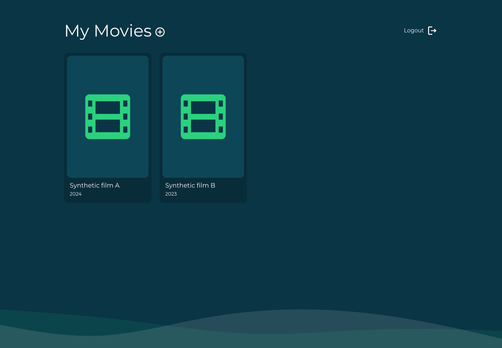
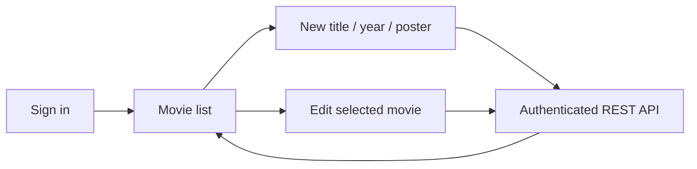

# Movie-list React client

A React 18 interface for a private movie catalog: sign in, view saved movies, create an entry with a poster, and edit an existing title/year. This repository contains the browser client. The matching [movie-list-rest-api](https://github.com/dev-nezuko/movie-list-rest-api) supplies authentication, storage and uploads; no database is bundled here.



[390px mobile view](docs/screenshots/mobile.png). These screenshots use synthetic titles and mocked API responses, not a live account or commercial movie artwork.

## Local setup

Use Node 22 and the npm lockfile:

```sh
npm ci --ignore-scripts
cp .env_sample .env
npm start
```

The UI defaults to `http://localhost:3000`. `REACT_APP_SERVER_URL` selects the API origin and defaults to `http://127.0.0.1:3001` if unset. Run the backend separately with your own local database and account configuration. The API must allow the frontend's origin. React environment values are public in the built bundle; no secret belongs in them.

```sh
npm test -- --watchAll=false --runInBand
npm run build
```

## Screens and contract



The service sends login credentials to `POST /login`, then uses the returned `token` as a bearer token. List requests read `GET /movies?page=1&pageSize=10`. Create/update forms send multipart `title`, `publicationYear`, and an optional replacement `image`; returned movie records expose `publishYear`. These field names were checked against the companion backend source, not a live MongoDB run.

Cards are keyboard-accessible edit buttons with responsive columns. Poster object URLs are released on cleanup, and missing artwork has a local placeholder. New entries require a poster; uploads accept one PNG/JPEG up to 5 MiB, matching the backend's size limit. Client-side file checks improve UX but do not replace server validation. Save failures remain visible instead of silently returning to the list. A direct edit URL without navigation state offers a return link rather than a blank page.

“Remember email” stores only the email preference, never the password. The bearer token still lives in local storage and is readable to JavaScript; an HttpOnly-session design would need coordinated backend work. Local sign-out clears the token even when the API is unavailable; provider/server revocation cannot be confirmed when that request fails.

## Evidence and limits

Six Jest tests pass for loading, empty/list/error rendering, logout despite API failure and poster-URL cleanup. The CRA production build passes. A Chrome/Playwright check used a synthetic login/list fixture, exercised desktop and 390px card layouts, uploaded a synthetic image, verified visible save failure, confirmed Cancel does not write, and cleared local state after a simulated logout 503.

No real account, movie poster, MongoDB database or live upload API was used. Live authentication, CORS and data persistence remain unverified. Existing React/Router testing deprecation warnings remain.

The UI currently fetches only the first ten movies and has no pagination controls, delete action, registration screen or video playback. Edit refresh/deep-link recovery needs a movie-by-ID request instead of navigation state. Those are clearer next steps than presenting this catalog as a complete streaming product. The duplicate pnpm lockfile was removed so npm has one authoritative dependency snapshot.
